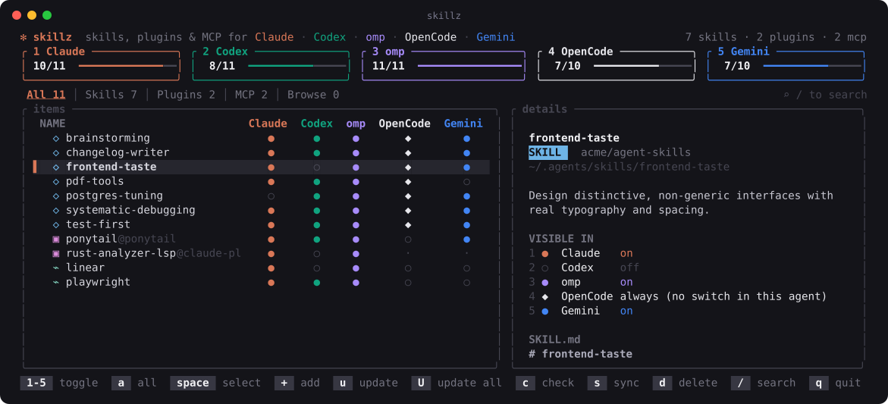

<div align="center">

# ✻ skillz

**One TUI for every agent's skills and plugins.**
See, switch, update and remove them across **Claude Code**, **Codex**, **omp**, **OpenCode** and **Gemini CLI** without hand-editing five config formats.



</div>

---

## Why

Every coding agent loads skills from its own folders and turns them off in its own config format. Claude Code uses symlinks and `enabledPlugins`. Codex uses `[[skills.config]]` in TOML. omp uses `ignoredSkills` and its own plugin registry. Gemini uses `skills.disabled`. OpenCode uses its `plugin` list.

Install a skill in one place and some agents see it while others don't. Install a plugin twice from two marketplaces and you get duplicates. `skillz` puts all of it in one table:

```
NAME                 Claude  Codex  omp  OpenCode  Gemini
◇ brainstorming        ●       ●     ●      ◆        ●
◇ pdf-tools            ●       ●     ●      ◆        ○
▣ ponytail@ponytail    ●       ●     ●      ●        ●
```

Press `1`–`5` to switch an agent on or off for the selected row. `skillz` writes the change into that agent's own config. It doesn't keep a database and doesn't copy files.

## Install

```sh
brew install olekmorawski/skillz/skillz
```

or from source (Rust 1.85+):

```sh
cargo install --git https://github.com/olekmorawski/skillz
```

Then run `skillz`.

## How it works

```
                  ~/.agents/skills/          ← the hub: one copy of every skill
                  ├── brainstorming/            (where `npx skills add -g` installs)
                  └── pdf-tools/
                           │
        ┌──────────┬───────┼──────────┬────────────┐
     Claude      Codex    omp     OpenCode      Gemini
    symlink     native   native    native       native
                      + a per-agent "off" switch in each agent's config

  Plugins live once, in Claude Code's plugin cache, and reach every other agent:
    Codex    → installed as a Codex plugin, or its skills linked into ~/.codex/skills
    omp      → reads Claude plugins directly (skillz turns that on)
    OpenCode → its own OpenCode plugin when the repo ships one, else skill links
    Gemini   → skill links in ~/.gemini/skills
```

**Skills** live in `~/.agents/skills` (the shared location used by `npx skills`). Codex, omp, OpenCode and Gemini read that folder natively. Claude Code gets a symlink per skill.

**Plugins** are installed once, through Claude Code (`/plugin`). Agents that can install the same plugin natively do so. The rest get symlinks to that one copy as `<plugin>--<skill>`. After a plugin update, `skillz sync` re-points the links.

### Where each switch is stored

| Agent | Skill off | Plugin off |
|---|---|---|
| **Claude Code** | removes the symlink in `~/.claude/skills` (its own copies are parked in `~/.agents/disabled`) | `enabledPlugins` in `~/.claude/settings.json` |
| **Codex** | `[[skills.config]] name = "…" enabled = false` in `~/.codex/config.toml` | `[plugins."…"] enabled = false`, or links removed |
| **omp** | `skills.ignoredSkills` | an override entry in `~/.omp/plugins/installed_plugins.json` (Claude stays untouched) |
| **OpenCode** | ◆ always on: OpenCode v2 always loads `~/.agents/skills` and has no per-skill switch | `plugin` list in `~/.config/opencode/opencode.json`, or links removed |
| **Gemini CLI** | `skills.disabled` in `~/.gemini/settings.json` | links removed from `~/.gemini/skills` |

Choices you make are remembered in `~/.agents/skillz.json`, so `skillz sync` never switches something back on after you turned it off.

## TUI

| Key | Action |
|---|---|
| `1` … `5` | switch the selected row for that agent (numbers match the cards at the top) |
| `a` | all agents on, or all off if they're already all on |
| `u` / `U` | update the selected row / update everything |
| `s` | sync (link new skills, follow plugins to every agent, clean broken links) |
| `d` | **remove completely** (see below) |
| `tab` `←` `→` | All / Skills / Plugins |
| `/` | filter by name, source or description; `esc` clears |
| `↑↓` `j k` `g G` `PgUp PgDn` | move |
| `r` / `q` | reload / quit |

Symbols: `●` visible · `○` hidden · `◆` always visible (the agent has no switch) · `·` doesn't apply (e.g. an LSP-only plugin has nothing Gemini can load) · `⚠` duplicate.

## CLI

```sh
skillz list                         # the table, in plain text
skillz sync                         # what's out of sync (dry run)
skillz sync --apply                 # fix it
skillz update                       # npx skills update, claude/codex/omp plugin updates, then sync
skillz enable  pdf-tools            # every agent
skillz disable pdf-tools gemini     # just Gemini
skillz rm brainstorming             # remove completely (asks first; -y to skip)
```

Plugins are addressed by id (`ponytail@ponytail`) or by bare name when it's unique.

### `rm`: remove completely

`skillz rm` (or `d` in the TUI) removes the item from everywhere, not just one agent:

- **Skill:** the hub folder and its `npx skills` lock entry, every agent's copy or symlink (`~/.claude`, `~/.codex`, `~/.gemini`, `~/.config/opencode`, `~/.omp`, `~/.pi`), parked copies, and every on/off rule that mentions it.
- **Plugin:** the Claude Code install and all cached versions, the Codex plugin, omp entries, the OpenCode plugin entry, every `<plugin>--*` link, `enabledPlugins` and remembered choices.

## Duplicates

The same plugin from two marketplaces, or a hub skill that a plugin also ships, gets a `⚠` badge. `skillz sync` reports it too. Keep one and `d` the other.

## Good to know

- Restart an agent after switching it. Agents read their skill lists at startup.
- OpenCode v2 offers no way to hide a single skill that comes from `~/.agents/skills`, so those rows show `◆`.
- Plugins that only ship LSP servers, agents or hooks show `·` for Gemini and OpenCode, because those agents can only load a plugin's skills.
- `skillz` only edits the keys it owns. Claude's `settings.json` and Gemini's `settings.json` are re-read before writing, so other settings survive. An `opencode.json` with comments (JSONC) is left alone and you get a message instead.
- An agent column appears when its home exists: `~/.claude`, `~/.codex`, `~/.omp`, `~/.config/opencode`, `~/.gemini`.

## Development

```sh
cargo test                                                     # unit tests
SKILLZ_SVG=docs/screenshot.svg cargo test screenshot -- --ignored   # regenerate the README image
```

The screenshot is the real TUI render from a demo `$HOME` (`src/demo.rs`), exported to SVG.

## License

MIT
